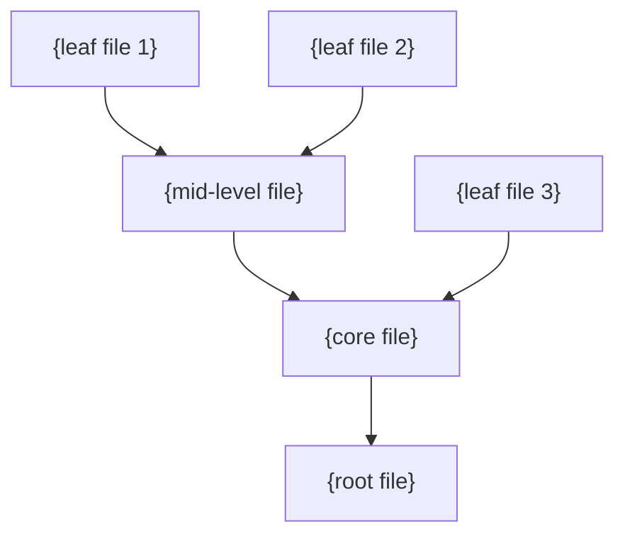

# Template: Migration Plan
<!-- output: .claude/repo-migration-plan.md -->
<!-- agents: D1, D2, D5, D6, D10 -->

## Synthesis Instructions

The user must specify or the skill must detect **what** is being migrated (e.g., "React class → hooks", "JavaScript → TypeScript", "REST → GraphQL", "monolith → microservices", "framework upgrade"). Quantify scope exhaustively. Use **leaf-first ordering** (migrate files with no dependents first, work up the dependency tree). Score per-item risk on 5 factors. Classify effort into 5 buckets. Include a coexistence plan for the transition period.

## Template Structure

```markdown
# Migration Plan: {from} → {to}
## {project_name}
> Generated on {date}

## Executive Summary
- **Migration type**: {e.g., "Language migration: JavaScript → TypeScript"}
- **Total scope**: {N} files, ~{N} lines of code
- **Already migrated**: {N} files ({X}%)
- **Estimated total effort**: {range} ({N} automated, {N} manual)
- **Recommended strategy**: {Leaf-First / Strangler Fig / Big Bang}
- **Estimated calendar time**: {range, accounting for parallel work and testing}

## Strategy Decision

{Recommend one of three strategies based on the migration type and codebase characteristics:}

| Strategy | When to Use | Risk | Speed |
|----------|-----------|------|-------|
| **Leaf-First** (recommended for most) | Clear dependency graph, items can be migrated independently | Low | Moderate |
| **Strangler Fig** | Replacing a subsystem/service, need continuous deployment | Low | Slow |
| **Big Bang** | Small scope (<20 files), tightly coupled, can't coexist | High | Fast |

**Recommended for this project**: {strategy} because {1-2 sentence justification based on dependency analysis and codebase structure}.

## Quantified Scope Assessment

### Overall Metrics
| Metric | Value |
|--------|-------|
| Total files in scope | {count} |
| Total lines of code in scope | {count} |
| Already migrated | {count} () |
| Files without tests (higher risk) | {count} |
| Avg complexity per file | {Low/Medium/High} |

### Effort Classification
{Classify every in-scope file into one of 5 buckets:}

| Bucket | Description | File Count | Effort per File | Total Effort |
|--------|------------|-----------|----------------|-------------|
| **Automated** | Can be fully auto-migrated (codemod/tool) | {N} | ~0 min | {time} |
| **Semi-automated** | Auto-migrate + manual review/fixes | {N} | 5-15 min | {time} |
| **Manual — Simple** | Straightforward manual migration, clear patterns | {N} | 15-45 min | {time} |
| **Manual — Complex** | Non-trivial logic, edge cases, dependencies | {N} | 1-3 hours | {time} |
| **Requires Redesign** | Can't be directly migrated, needs rethinking | {N} | 3+ hours | {time} |
| **Total** | | **{N}** | | **{range}** |

### Complexity Breakdown
| File | Bucket | Complexity Factors | Dependencies | Has Tests | Risk Score |
|------|--------|-------------------|-------------|-----------|-----------|
| `{file}` | {bucket} | {factors: LOC, nesting depth, external deps} | {N imports, N importers} | Yes/No | {1-5} |
| ... | ... | ... | ... | ... | ... |
{List all files, sorted by migration order (leaf-first). For large scopes, show top 20 + summary.}

## Dependency Graph & Migration Order

{Visualize the dependency structure:}


**Migration order**: Migrate bottom-up (leaves first). Files at the same level can be migrated in parallel.

### Phase 1: Leaf Files ({count} files, {effort range})
{Files with no downstream dependents — safest to migrate first.}

| # | File | Bucket | Imported By | Risk | Effort | Notes |
|---|------|--------|-----------|------|--------|-------|
| 1 | `{file}` | {bucket} | {N files} | {1-5} | {time} | {any special considerations} |
| ... | ... | ... | ... | ... | ... | ... |

### Phase 2: Mid-Level ({count} files, {effort range})
{Files whose leaf dependencies are all migrated in Phase 1.}

| # | File | Bucket | Depends On (migrated?) | Imported By | Risk | Effort |
|---|------|--------|----------------------|-----------|------|--------|
| ... | ... | ... | {list — all should be Phase 1} | ... | ... | ... |

### Phase 3: Core/Root ({count} files, {effort range})
{Central files that many things depend on — migrate last, highest risk.}

| # | File | Bucket | Depends On | Imported By | Risk | Effort | Notes |
|---|------|--------|-----------|-----------|------|--------|-------|
| ... | ... | ... | ... | {many} | {high} | ... | {may need staged approach} |

## Risk Assessment

### Per-Item Risk Scoring
{Each file scored on 5 factors (1-5 each):}

| Factor | Weight | Description |
|--------|--------|-------------|
| Complexity | 25% | LOC, nesting depth, number of branches |
| Dependents | 25% | How many files import this — blast radius of breakage |
| Test Coverage | 20% | Has tests = lower risk, no tests = higher risk |
| External Dependencies | 15% | Uses external APIs, SDKs, or complex libraries |
| Business Criticality | 15% | Handles payments, auth, core business logic |

### High-Risk Items
| File | Risk Score | Key Risk Factors | Mitigation |
|------|-----------|-----------------|-----------|
| `{file}` | {score}/25 | {factors} | {specific mitigation: add tests first, pair review, feature flag} |
| ... | ... | ... | ... |

## Coexistence Plan

{During migration, old and new code must coexist. Define the rules:}

### Boundary Rules
- **Import convention**: {e.g., "Migrated TS files can import from JS. JS files import from TS using {approach}."}
- **Type sharing**: {e.g., "Shared types go in {directory}. Both old and new code reference them."}
- **Build configuration**: {changes needed to support both formats during transition}

### Lint Rules for Transition
{Prevent regression — enforce migration direction:}
```
{lint rule or config that prevents NEW code from using the old pattern}
{e.g., "eslint rule: no-restricted-syntax to block new class components"}
{e.g., "tsconfig strict: true for new files, loose for not-yet-migrated"}
```

### Feature Flags (if applicable)
{For runtime migrations, list features that should be behind flags during transition}

## Codemod / Automation Recommendations

| Tool/Codemod | What It Automates | Files Affected | Confidence | Manual Review Needed |
|-------------|-------------------|---------------|-----------|---------------------|
| {e.g., jscodeshift transform} | {what it transforms} | {N} files | {High/Medium} | {Yes — check X / No} |
| {e.g., built-in framework CLI} | {what it does} | {N} files | ... | ... |

**Automation coverage**: {X}% of files can be fully or semi-automated.

{If no codemods exist: "No existing codemods found for this migration. Consider writing a custom transform for the {N} files that follow the same pattern — see {pattern description}."}

## Testing Strategy

### Before Each Migration Step
- [ ] Verify existing tests pass for the file being migrated
- [ ] If no tests exist, write characterization tests BEFORE migrating

### After Each Migration Step
- [ ] All existing tests still pass (or are updated to match new API)
- [ ] New tests added for any changed behavior
- [ ] Integration tests confirm the migrated file works with both migrated and unmigrated consumers
- [ ] {Framework-specific check, e.g., "App builds without warnings", "Type-check passes"}

### Regression Testing Cadence
- After each phase: full test suite + manual smoke test of key flows
- CI must pass before merging any migration PR

## Rollback Assessment

| Phase | Rollback Difficulty | Rollback Method | Time to Rollback |
|-------|-------------------|----------------|-----------------|
| Phase 1 | Easy | `git revert` individual PRs | Minutes |
| Phase 2 | Moderate | Revert PRs, may need dependency updates | Hours |
| Phase 3 | Difficult | Core changes affect many files | Days |

{For high-risk phases: "Consider a feature branch for the entire phase, merged only when fully validated."}

## Estimated Timeline

| Phase | Files | Effort | Calendar Time (1 dev) | Calendar Time (2 devs) |
|-------|-------|--------|----------------------|----------------------|
| Phase 1 | {N} | {hours} | {days} | {days} |
| Phase 2 | {N} | {hours} | {days} | {days} |
| Phase 3 | {N} | {hours} | {days} | {days} |
| Testing & validation | — | {hours} | {days} | {days} |
| **Total** | **{N}** | **{hours}** | **{days}** | **{days}** |

## Positive Observations
{Acknowledge progress already made and good patterns that ease the migration}
```
